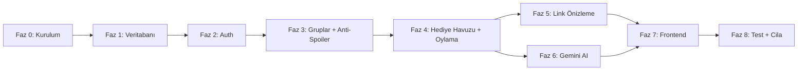

# 🗺️ CovertGift — Geliştirme Yol Haritası (Roadmap)

> Referans: [PROJECT_CONTEXT.md](./PROJECT_CONTEXT.md)
> İlerledikçe kutucukları `[x]` olarak işaretle. Her fazın sonunda **✅ Kabul Kriterleri** sağlanmadan sonraki faza geçme.
> Son doğrulama: **2026-11-13** (davet linki + MULTI gruplar, yerel): Go birim + entegrasyon testleri, Vitest 218/218, Playwright 18/18 (9 test × masaüstü/telefon; test veritabanına karşı). Azure'a dağıtılmadı. Önceki not — Vitest 151/151 (14 dosya). Go testleri, entegrasyon testleri ve Playwright son olarak #20/#21 geliştirmesinde geçti (Playwright: 8 test × masaüstü/telefon = 16 senaryo; bu doküman güncellemesinde yeniden çalıştırılmadı). Azure'da API ve React frontend `f883801` canlı; dağıtım sonrası salt-okunur kontroller geçti ([docs/AZURE.md](docs/AZURE.md)).

---

## Faz 0 — Ortam ve Proje İskeleti
- [x] Go kurulumu (`/opt/homebrew/bin/go`)
- [x] Docker Desktop kurulumu ve çalıştığının doğrulanması (`v29.8.0`, `v5.5.1`)
- [x] Git deposu başlat ve `.gitignore` yapılandır
- [x] `docker-compose.yml` → PostgreSQL 17 servisi (port `5432`, volume, healthcheck - test edildi)
- [x] `backend/` klasör yapısı (`cmd/api`, `internal/...`, `pkg/...`)
- [x] `go mod init` + bağımlılıklar: `gin`, `gorm`, `postgres`, `jwt`, `bcrypt`, `uuid`, `godotenv`, `decimal`
- [x] `.env.example` ve `.env` yapılandırması (`JWT_SECRET` üretildi)
- [x] `internal/config` → env okuma (`config.go`)
- [x] `cmd/api/main.go` ve `GET /health` endpoint'i

**✅ Kabul:** `docker compose up -d` + `go run ./cmd/api` → `GET /health` 200 döner (Doğrulandı ✅).

---

## Faz 1 — Veritabanı Modelleri ve Migrasyon
- [x] UUID desteği doğrulandı (PostgreSQL 17'de `gen_random_uuid()` yerleşiktir, pgcrypto gerekmez)
- [x] `models.User`
- [x] `models.Group` (`TargetUserID *uuid.UUID`, `TotalBudget decimal`)
- [x] `models.GroupMember` (UNIQUE `group_id,user_id`, CASCADE)
- [x] `models.GiftIdea` (`product_url` dahil, CASCADE)
- [x] `models.Vote` (UNIQUE `gift_idea_id,user_id`, CASCADE, `vote_type` CHECK IN (-1,1))
- [x] `AutoMigrate` çağrısı + bağlantı havuzu ayarları (Doğrulandı ✅)
- [x] Standart yanıt yardımcıları: `RespondOK(c, data)`, `RespondErr(c, status, msg)`

**✅ Kabul:** `psql` ile `\dt` → 5 tablo (`gift_ideas`, `group_members`, `groups`, `users`, `votes`) doğrulandı ✅.

---

## Faz 2 — Kimlik Doğrulama (Auth)
- [x] `repository/user_repo.go` (Create, FindByEmail, FindByID)
- [x] `services/auth_service.go` (bcrypt hash, JWT üretimi — 24 saat geçerlilik)
- [x] `POST /api/v1/auth/register` → 201 (e-posta çakışmasında 409)
- [x] `POST /api/v1/auth/login` → `{ token, user }` (şifre hash'i asla dönmez)
- [x] `middleware/auth.go` → `Authorization: Bearer` doğrula, `userID` context'e yaz
- [x] `GET /api/v1/me` (kullanıcı profil detayı)
- [x] `DELETE /api/v1/me` (kullanıcının kendi hesabını, oluşturduğu grupları ve verilerini silmesi)

**✅ Kabul:** Kayıt → giriş → token ile korumalı endpoint 200; tokensız 401 (Doğrulandı ✅).

---

## Faz 3 — Grup İşlemleri ve Anti-Spoiler 🛡️
- [x] `middleware/group_access.go` → `:id` grubunu yükle;
  - [x] Kullanıcı `target_user_id` ise **403** + sürpriz mesajı
  - [x] Kullanıcı üye değilse **403/404**
  - [x] Grubu ve rolü context'e yaz
- [x] `POST /api/v1/groups` (transaction: grup + oluşturan `admin` üye)
- [x] `GET /api/v1/groups` (hedef kişi olduğu gruplar filtrelenir)
- [x] `GET /api/v1/groups/:id` → `member_count`, `per_person_budget` (anlık hesap, 0'a bölme kontrolü)
- [x] `POST /api/v1/groups/:id/members` (e-posta ile; hedef kişi üye **eklenemez**; zaten üyeyse 409)
- [x] Hedef kişiyi e-postayla seçme ve sonradan bağlama (2026-10-21): `POST /groups` isteğe bağlı `target_email` kabul eder (kayıtlı değilse 404, kendini seçme 400, UUID ile birlikte 400). `PATCH /groups/:id/target` yalnızca admin içindir; hedef bir kez bağlanır (bağlıysa 409), grubun üyesi hedef olamaz (409). Kontroller ve üye ekleme grup satırı kilidiyle korunur. Ayrı kullanıcı arama ucu açılmadı.
- [x] İlgi alanları listesi (2026-10-16): `POST /api/v1/groups/:id/interests` ile tüm üyeler tek tek ekleyebilir; `DELETE` ile yalnızca admin silebilir. Anti-Spoiler korunur. Eski toplu `PATCH` kaldırıldı; geçici panelde liste ve “Ekle” alanı var. Eşzamanlı eklemeler satır kilidiyle korunur.
- [x] `PATCH /api/v1/groups/:id/budget` — Admin toplam bütçeyi güncelleyebilir (2026-10-16). Kişi başı tutar ve mevcut hediye bütçe aşımı uyarıları yenilenir; geçici panelde admin için bütçe formu eklendi.
- [x] `DELETE /api/v1/groups/:id` (grubun, fikirlerin, oyların ve üyelerin admin tarafından atomik silinmesi)

**✅ Kabul:** Hedef kullanıcı tüm `/groups/:id/*` uçlarında 403 alır; listede grubu görmez (Doğrulandı ✅).

---

## Faz 4 — Hediye Havuzu ve Oylama
- [x] `GET /api/v1/groups/:id/ideas` → `score = COALESCE(SUM(vote_type),0)`, `my_vote`, skora göre sıralı
- [x] `POST /api/v1/groups/:id/ideas` → manuel öneri (`source_type = MANUAL`)
- [x] `POST /api/v1/ideas/:id/vote` → `ON CONFLICT (gift_idea_id,user_id) DO UPDATE` (GORM `clause.OnConflict`)
- [x] `DELETE /api/v1/ideas/:id` → sadece öneren veya grup admini
- [x] ⚠️ `/ideas/:id/*` uçlarında da **Anti-Spoiler**: fikrin grubunu bulup aynı kontrolü uygula

**✅ Kabul:** Aynı kullanıcı iki kez oy verince kayıt güncellenir (çoğalmaz); yetkisiz silme 403 (Doğrulandı ✅).

---

## Faz 5 — Ürün Linki Önizleme (`pkg/linkpreview`) 🔗
> Prototip: `prototypes/linkpreview/` — Modüler ayrıştırıcı mimarisi (Trendyol, Amazon TR, Hepsiburada, Generic fallback).
> Backend Paketi: `backend/pkg/linkpreview/` — Tamamen entegre edildi ve birim testleri ile doğrulandı.

- [x] Prototipi pakete taşı: `linkpreview.Fetch(ctx, url) (*Preview, error)`
- [x] Adjust tracker çözümleme (`adjust_redirect`)
- [x] Fiyat: `product:price:amount` → JSON-LD Offer fallback → state JSON
- [x] Jenerik görsel filtresi (`mrktng`, `/crm/`, `popup`, `banner`…)
- [x] 🐞 Tek/çift tırnak regex hatasını düzelt (`og:description` "Trendyol'da"da kesilmez)
- [x] HTML entity decode (`&amp;`, `&#39;`, `&imath;`, `&scedil;` vb.)
- [x] Başlıktan `search_query` türet ("- Fiyatı", satıcı adı temizliği)
- [x] 🔒 SSRF koruması: domain allowlist + dial-seviyesi özel IP engeli + 2 MB limit + max 10 redirect
- [x] `POST /api/v1/groups/:id/ideas/preview-link` endpoint'i (Anti-Spoiler korumalı, partial fallback)
- [x] Birim testleri (kaydedilmiş HTML fixture'ları ile, ağ olmadan: `go test -v ./pkg/linkpreview`)
- [x] Amazon TR / Hepsiburada / Trendyol canlı testleri ve doğrulamaları

**✅ Kabul:** `ty.gl` linki → doğru başlık + ürün görseli + 699.00 TRY; `amzn.eu` linki → hiRes ürün görseli + 1553.94 TRY; `http://127.0.0.1` reddedilir; hedef kullanıcı 403 alır (Doğrulandı ✅).

---

## Faz 6 — Gemini AI Önerileri 🤖
- [x] `pkg/gemini` istemcisi (`google.golang.org/genai`, araştırma: `GEMINI_RESEARCH_MODEL=gemini-3.8-flash`; seçim: `GEMINI_MODEL=gemini-3.5-flash-lite`). Güncel (2026-11-10'dan beri, Search kapalı): `GEMINI_MODEL=gemini-3.6-flash`, yedek `GEMINI_FALLBACK_MODEL=gemini-3.5-flash-lite`.
- [x] İki aşamalı üretim: Google Search ile Türkiye mağazalarında ürün/TL fiyatı araştırması → `response_schema` ile `[{ title, description, estimated_price, search_query, evidence_ids }]` seçimi. Model URL üretmez; `ai_sources` yalnızca grounding metadata'sından gelir.
- [x] State-based prompt: `target_interests` + bütçe + mevcut başlıklar + reddedilen/veto edilen başlıklar (Kural 4)
- [x] `POST /api/v1/groups/:id/ideas/generate-ai` → en fazla 5 kaynaklı öneri, `source_type = AI`, batch insert. Yeterli geçerli ürün yoksa 3'ten az sonuç dönebilir.
- [x] 503 hatasında otomatik yedek model geçişi (`gemini-3.5-flash-lite`); araştırma/JSON ayarları yedek çağrıda korunur. Diğer API hataları üst katmana iletilir.
- [x] Kaynak, ürün adı ve fiyat eşleşmesi; pozitif tutar, veritabanı sınırları ve normalize edilmiş tekrar kontrolü için birim testleri
- [x] Bütçe üstü öneriler sunucu tarafında çöpe atılmaz; `is_over_budget: true` bayrağı ile işaretlenir (Grup toleransına bırakılır)
- [x] 👑 **Admin Vetosu:** `POST /api/v1/ideas/:id/reject` → Sadece grup yöneticisi tek tıkla reddeder (`status = REJECTED`)
- [x] 🗳️ **Demokrasi Vetosu:** Fikre verilen downvote sayısı üye sayısının yarısını geçerse ($downvotes > N/2$) otomatik `status = REJECTED`
- [x] 🔄 **Negatif Prompt Beslemesi:** Reddedilen fikirler silinmez, sonraki AI prompt'larına negatif kısıt olarak verilir

**✅ Kabul:** Kaynakla desteklenen ve doğrulamadan geçen en fazla 5 öneri DB'ye yazılır. Mevcut/reddedilmiş başlıklarla normalize edildiğinde eşleşen ürünler elenir; reddedilenler sonraki prompt'a negatif kısıt olarak eklenir. Benzer ürünlerin anlamsal olarak tamamen engellenmesi garanti edilmez. Araştırma/seçim, filtre ve 503 yedeği birim testleri geçti (2026-10-17); gerçek API testi isteğe bağlıdır ve bu oturumda tekrar çalıştırılmadı.

---

## Faz 7 — React Frontend 🎨
> 2026-10-16: Backend'i tarayıcıdan denemek için geçici `prototypes/test-ui/` paneli eklenmişti. 2026-10-21'de kalıcı React frontend `frontend/` altında tamamlandı ve Azure'da panelin yerini aldı. Tasarım mobil web önceliklidir.

- [x] `frontend/` → Vite + React + TypeScript (2026-10-21; React Router, TanStack Query, i18next TR/EN)
- [x] Tailwind CSS v4 + shadcn/ui (Button, Input, Label, Dialog, Sonner — elle eklendi, `radix-ui`) + Lucide Icons
- [x] `src/api/` katmanı (fetch tabanlı; Bearer token localStorage'da; 401 → token silinir, login'e yönlendirilir)
- [x] Auth sayfaları: Giriş / Kayıt (kayıt sonrası otomatik giriş)
- [x] Grup listesi + "Yeni Grup" diyaloğu (grup sayfasının ilk sürümü: bütçe, kişi başı, ilgi alanları, üyeler)
- [x] **Ana panel (tek ekran):**
  - [x] Üst bar: profil, toplam bütçe, kişi başı bütçe (2026-10-21: profil ve grup seçici yüzen üst barda; toplam ve kişi başı bütçe grup sayfasının kutucuklarında)
  - [x] Orta: oylama kartları (görsel, başlık, fiyat, skor, ▲/▼, AI/MANUAL rozeti, bütçe üstü etiketi; elenenler altta katlanır bölümde)
  - [x] Kartlarda Trendyol / Amazon TR dinamik arama linkleri (`encodeURIComponent`)
  - [x] MANUAL + `product_url` varsa "Ürüne git" linki
  - [x] Sağ panel: üyeler, üye ekle; **"Gemini ile Öner"** havuz başlığında (loading durumu, 429/422/503 mesajları; 2026-10-21 canlı çağrı arayüzden doğrulandı)
- [x] "Manuel Ekle" diyaloğu → link yapıştır → önizleme ile form otomatik dolar (kısmi önizlemede elle tamamlama)
- [x] AI kaynaklarını (`ai_sources`) ve Google arama önerilerini (`ai_search_suggestions`) izole biçimde göster (kaynaklar katlanır listede; öneri HTML'i betiksiz sandbox iframe'de; gerçek veriyle henüz görülmedi)
- [x] 403 Anti-Spoiler için özel "Bu bir sürpriz!" ekranı
- [x] Optimistic UI ile oylama (yanıt skor döndürmediği için ardından liste yeniden çekilir; oy yalnızca değiştirilebilir)
- [x] Toast bildirimleri, boş durumlar, iskelet (skeleton) yükleyiciler

- [x] Grup sayfasında yerinde yönetim (2026-10-21): ilgi alanı ekleme (tüm üyeler) ve silme (admin), toplam bütçeyi düzenleme (admin), grubu onaylı silme (admin)
- [x] Hesabı silinmiş oturumun kapanması: `/me` 404 dönünce token silinir, giriş ekranına dönülür (2026-10-21)
- [x] Rota bazlı kod bölme; ana paket 619 kB'den 446 kB'a indi, 500 kB uyarısı kalktı (2026-10-21)
- [x] Görsel yenileme (2026-10-22): koyu tema Discord'a benzediği için "Nötr grafit"e geçti (renksiz grafit yüzeyler); ana renk iki temada saf kobalt `#2f5bff` (eski `#4e5cff`/`#2436ff` Discord blurple'ı ile aynı 235° tonundaydı). Giriş/kayıt ekranında form daraltıldı, ürün paneli içeriği kadar ortalandı. Üç alternatif gerçek ekranlarda karşılaştırılarak seçildi.
- [x] Azure dağıtımı (2026-10-21): `frontend/Dockerfile` + nginx (`/api` proxy, SPA, güvenlik başlıkları, `/api/v1/dev/*` 403); `covertgift-ui` uygulaması React frontend'i çalıştırıyor. Ayrıntı: [docs/AZURE.md](docs/AZURE.md)
- [x] Frontend testleri (2026-10-21): Vitest + Testing Library + MSW ile 30 bileşen/akış testi; Playwright ile gerçek API'ye karşı kabul akışı ve Anti-Spoiler senaryosu (masaüstü + telefon)
- [x] Hedef kişi arayüzü (2026-10-21): yeni grup diyaloğunda isteğe bağlı "Hedef kişinin e-postası" (kayıtlı değilse alan altında uyarı, grup kurulmaz; alan boşaltılınca yalnızca isimle kurulur); admin menüsünde "Hedef kişiyi bağla" (yalnızca hedef bağlı değilken); başlıkta "hesabı bağlı" etiketi. Testler 37 Vitest + 6 Playwright (Anti-Spoiler grubu artık arayüzden kuruluyor)

**✅ Kabul:** Kayıt → grup kur → üye ekle → AI öner → link ile manuel ekle → oyla akışı uçtan uca çalışır. (2026-10-21: Playwright kabul testi kayıt → grup → üye → manuel fikir → oy akışını gerçek API'ye karşı doğruluyor; link önizlemesi dış ağa çıktığı için testte form elle doldurulur. AI önerisi kota harcamamak için otomatik teste alınmadı, aynı gün arayüzden elle denendi.)

---

## Faz 8 — Test, Güvenlik ve Cila 🧪
- [x] Swagger / OpenAPI 2.0 canlı dokümantasyonu (`swaggo/swag`, `/swagger/index.html`, `/docs`)
- [x] Veritabanı sıfırlama endpoint'i ve Swagger'dan çağrı (`POST /api/v1/dev/reset-db`; `ALLOW_DB_RESET` + onay gerekir)
- [x] Bağımlılıksız geçici test paneli ve API yolu allowlist'i; geliştirme sıfırlama ucu proxy'de engellenir
- [x] Cloudflare Quick Tunnel ile panel ve API'ye aynı HTTPS adresinden erişim; arayüz 200, sağlık kontrolü 200 (`db: up`), oturumsuz profil 401 (2026-10-17)
- [x] İlgi alanı yetkileri, bütçe doğrulaması/uyarıları, AI kaynak ve tekrar filtreleri için backend birim testleri
- [x] **Güvenlik güncellemeleri (2026-10-23 taraması):** 2026-11-09'da uygulandı; canlı imajlar `security-20261109`.
  - [x] Go 1.27.1 → **1.27.3** (`backend/Dockerfile` ve `go.mod`): eMudhra ara CA anahtarlarının ele geçirilmesi (CVE-2026-111943, `crypto/x509` engeli yalnızca yeniden derlemede etkin) ve standart kütüphanede 11 açık (HTTP/2, HTTP/1, `html/template`; 1.27.2'de kapalı). Etkilenen giden TLS: Gemini, link önizleme, Azure PostgreSQL.
  - [x] `golang.org/x/net` v0.58.0 → v0.60.0+, `google.golang.org/grpc` v1.66.2 → v1.83.1+, `github.com/quic-go/quic-go` v0.59.0 → v0.59.1+ (Gin'in dolaylı bağımlılıkları). Doğrulama: `govulncheck ./...` temiz çıkmalı.
  - [x] Frontend nginx `nginx-unprivileged:1.27-alpine` (canlıda 1.27.5, Alpine 3.21.3, OpenSSL 3.3.3) → **1.30.6+ stable**. 1.27 hattı desteksiz; 2026'daki 26 bildirimin 22'sinde etkilenen sürümler arasında. Yapılandırmayla kesişenler: CVE-2026-42533 (`map` + regex; yakalama kullanmadığımız için muhtemelen tetiklenmez) ve CVE-2026-1642 (TLS'li upstream proxy).
  - [x] Node derleme imajı `node:22-alpine` → 22.23.4+ (21 Ekim sürümü, Brotli RCE dahil 10 CVE; Node yalnızca derlemede kullanılıyor). Yerel Node v26.8.1 → 26.12.1+.
  - [x] Testler + `govulncheck` + `npm audit`, iki imajı commit etiketiyle yeniden derleyip Azure'a dağıtma, canlı smoke test. Azure ortamı 2026-10-23'ten beri **kapalı**; yeniden açmadan önce bu madde tamamlanmalı (açma adımları [docs/AZURE.md](docs/AZURE.md)).
  - Durum: npm bağımlılıkları temiz (`npm audit` 0); yerel PostgreSQL 17.11 güncel; Azure PostgreSQL Microsoft tarafından yamalanıyor.
- [x] Backend Anti-Spoiler entegrasyon testleri (2026-11-09): gerçek router + geçici `test-db` ile 18 korumalı uç, grup listesi, üye olmayan, hedefi üye ekleme ve sonradan bağlama senaryoları (`backend/cmd/api/antispoiler_integration_test.go`). Diğer akışlar için entegrasyon testleri henüz yok.
- [x] Gemini kota/istek sınırı hatasını HTTP 429 olarak döndür; istemci ve controller testleriyle doğrula
- [ ] Kalan AI hata yanıtlarını ayrıştır: kaynaksız araştırma şu an 500 döner; 422 eşlemesi ve geçici servis hataları için 503 yanıtı ekle — **Ertelendi (2026-11-09):** AI bölümü ileride yeniden tasarlanacak; bu madde o çalışmayla birlikte ele alınacak. (2026-11-10: modelin kalıcı aşırı yükü artık 503 + "servis yoğun" mesajı döner; maddenin geri kalanı açık.)
- [x] CORS ayarları, istek boyutu limitleri, input validasyonu (2026-11-09): tüm isteklerde 1 MiB gövde limiti (aşılırsa 413); oluşturmada bütçe ve manuel fikirde fiyat doğrulaması (0–99.999.999,99, iki ondalık); metin alanlarına sütun boyutlarıyla uyumlu `max`, `product_url`/`image_url` için `http_url`, oy için `oneof=1 -1`. CORS bilinçli olarak yok (aynı origin); kullanılmayan `CORS_ORIGIN` kaldırıldı.
- [x] Hata loglama (2026-11-09): `log/slog` (production'da JSON), istek başına tek satır (`request_id`, yöntem, yol, durum, süre; sorgu, gövde ve Authorization loglanmaz), `X-Request-ID` başlığı, panik kurtarma. 500 yanıtları iç hatayı artık istemciye göstermez, loga yazar.
- [x] Seed script (2026-11-09): `go run ./cmd/seed` — 4 demo kullanıcı, hedefi bağlı grup, 3 fikir, oylar. Tek transaction, yalnızca ekler, idempotent, production'da reddeder.
- [x] Yerel veri koruması (2026-10-22, 2026-11-09'da çözüldü: uç `ALLOW_DB_RESET=true` olmadan 403, açıkken gövdede `{"confirm": "RESET"}` yoksa 400; düzenli `pg_dump` yedeği SETUP'ta önerili): yerel API'de `POST /api/v1/dev/reset-db` açık ve Vite geliştirme proxy'si onu engellemiyor; 2026-10-21'de bir smoke testi yerel veritabanını bu uçla sildi. Seçenekler: ucu ayrı bir ortam bayrağına bağlamak, onay parametresi istemek veya Vite proxy'sinde engellemek; düzenli `pg_dump` yedeği. Karar verilmedi.
- [x] `README.md` → ilk `.env` kurulumu, backend/panel/tünel komutları ve doğrulama adımları (2026-10-17)
- [x] Backend, frontend (nginx) ve eski panel için Dockerfile ve `.dockerignore`; Azure demo dağıtım rehberi
- [x] (Opsiyonel) Backend ve frontend'i yerel Docker Compose'a ekleme (2026-11-09): `docker compose --profile app up -d --build` → http://localhost:8081. Eski panel eklenmedi (yerini React frontend aldı).

**✅ Kabul:** Temiz bir makinede README adımlarıyla proje 10 dakikada ayağa kalkar.

---

## 💡 Gelecek Fikirler (Backlog)
- [x] ~~**Hedef kişiyi e-postayla seçme ve sonradan bağlama**~~ — 2026-10-21'de tamamlandı (Faz 3 ve Faz 7'ye bakın).
- [x] **Hediye tarihi / doğum günü (2026-10-22; 2026-11-09'da yapıldı: tek seferlik `event_date`, geri sayım, yaklaşan tarihe göre sıralama, tarih geçince admin'e kazananı seçme hatırlatması; bildirim yok):** Gruba isteğe bağlı bir tarih alanı (`event_date`: doğum günü ya da hediyenin verileceği gün). Grup listesinde ve grup sayfasında geri sayım ("12 gün kaldı"), yaklaşan tarihe göre sıralama; yaklaşırken hatırlatma (ileride e-posta veya bildirim); tarih geçince grubu tamamlamayı önerme (kazanan seçimiyle bağlantılı). Hedef kişinin hesabındaki hiçbir bilgiye bağlanmaz ve hedefe hiçbir şey göstermez (Anti-Spoiler). Uygulama sırasında karar verilecekler: her yıl tekrar eden doğum günü mü tek seferlik tarih mi, saat dilimi (Europe/Istanbul), geçmiş tarihin kabulü, bildirim kanalı. Şema değişikliği GORM AutoMigrate ile.
- [ ] **Frontend cilaları (2026-10-21):** Oy sonrası liste yeniden sıralanınca kartların zıplamaması (yerleşim animasyonu ya da sıralamayı kısa süre sabitleme); Gemini önerisi gelince yeni kartların kısa süre vurgulanması; boş havuzda örnek link ve Gemini butonuyla daha yönlendirici bir boş durum. Azaltılmış hareket tercihine uyulacak.
- [x] **Oyu geri alma (2026-10-21; 2026-11-09'da yapıldı: `DELETE /ideas/:id/vote`, aynı oya tekrar basınca oy kalkar):** Backend şu an yalnızca +1/−1 upsert destekliyor; oy kaldırılamıyor. `DELETE /api/v1/ideas/:id/vote` (Anti-Spoiler + üyelik kontrolü, testli) eklenip arayüzde aynı oya tekrar basınca oy kaldırılacak. Kullanıcı isteğiyle sonraya bırakıldı; frontend'de oy yalnızca değiştirilebilir.
- [ ] **Manuel önerilerden AI tercih çıkarımı (2026-10-19):** Mevcut akış manuel/AI başlıklarını yalnızca tekrar etmeme listesi olarak gönderiyor; oy skorlarını göndermiyor. Manuel önerileri, özellikle beğenilenleri, olumlu tercih örnekleri olarak kullanarak yeni ve farklı ürünler ürettir. Reddedilen/veto edilen fikirleri olumsuz bağlamda tut; mevcut tekrar, kaynak ve fiyat doğrulamalarını koru. Kullanılacak alanlar ve oy ağırlıkları uygulama sırasında netleştirilecek.
- [ ] **Trendyol önizlemesinin Azure'da çalışması (2026-10-19):** LEGO 76424 / ürün `811478750` yerelde gerçek backend paketiyle eksiksiz önizleme verdi; Azure'daki HTTP kontrolünde aynı ürün `/pl/` Polonya sayfasına yönlenip 403 döndü. `storefrontId=1&countryCode=TR&language=tr` denemesi de yönlendirmeyi engellemedi. Kullanıcı Amazon ve Hepsiburada'nın canlıda çalıştığını bildirdi. Türkiye çıkışlı ayrı önizleme servisini önce doğrula; Türkiye IP'sinin tek başına çözüm olacağı varsayılmamalı. Frontend'e taşıma seçeneği CORS ve sayfa erişimi açısından ayrıca denenecek. Manuel doldurma/partial fallback ve SSRF korumaları korunacak. Çözüm seçilmedi ve canlıya bu konuda değişiklik uygulanmadı.
- [x] ~~**Grup Modları**~~ — 2026-11-13'te `SINGLE` / `MULTI` olarak yapıldı (aşağıda "Backlog 2026-11").
- [x] **Davet linki (2026-10-21 detaylandı; 2026-11-13'te paylaşılabilir, süreli grup linki olarak yapıldı — tek kullanımlık değil):** Şu an üye eklemek için kişinin önceden kayıtlı olması gerekiyor. Süreli ve tek kullanımlık davet bağlantısı üretilecek; bağlantıyı açan kişi kayıt/giriş sonrası gruba katılacak. Hedef kişi davetle de gruba giremez (Anti-Spoiler). Backend: davet modeli + uçlar; frontend: üyeler panelinde "Davet linki oluştur/kopyala" ve davet karşılama sayfası.
- [ ] Bireysel katkı takibi (kim ne kadar ödedi)
- [x] **Hediye "kazanan" seçimi ve grubu kapatma (2026-10-21; 2026-11-09'da yapıldı: `POST/DELETE /groups/:id/winner`, grup `COMPLETED`, yeniden açılabilir):** Modelde `SELECTED` durumu hazır. Admin en çok oyu alan (ya da seçtiği) fikri kazanan yapar; grup "tamamlandı" görünümüne geçer, oylama ve AI önerisi kapanır. Frontend'de kazanan kartı öne çıkar, ana sayfada grup "Tamamlandı" etiketiyle görünür. Backend: seçme ucu (yalnızca admin, Anti-Spoiler korumalı) ve grup durumu.
- [ ] Önizleme sonuçlarını önbellekleme (aynı URL için 24 saat)
- [x] **Gerçek zamanlı oy güncellemeleri (WebSocket / SSE) (2026-10-21 detaylandı; 2026-11-09'da yapıldı: `GET /groups/:id/events` SSE akışı; bağlantı yoksa 10 sn'lik yenileme yedek. Hub bellek içi, tek API kopyası için):** Başkasının oyu ve yeni fikirler sayfa yenilenmeden görünsün. İlk adım frontend'de grup sayfası açıkken belirli aralıklarla yeniden çekme (TanStack Query `refetchInterval`, sekme arka plandayken durur); kalıcı çözüm SSE. Hedef kişiye hiçbir olay gitmemeli.

---

## 📦 Backlog 2026-11 (tamamlananlar)
Ayrıntılar [docs/DEVLOG.md](docs/DEVLOG.md) içinde; hepsi 2026-11-13'te Azure'a `f883801` ile dağıtıldı.
- [x] **Birden çok kazanan (2026-11-09, #13):** `POST /groups/:id/winner` `{ idea_ids }` (1–20); seçim penceresi toplamı bütçeyle karşılaştırır.
- [x] **Ana ekran yeniden tasarımı (2026-11-10, #15):** "Sıradaki sürpriz", "Senden bekleyenler", "Gruplarım", "Geçmiş sürprizler"; `GET /groups` sayaçları (`member_count`, `idea_count`, `pending_votes`).
- [x] **Profil sayfası (2026-11-10, #15):** `PATCH /me` (ad + e-posta; e-posta değişince yeni token), `PUT /me/password`, hesap silme.
- [x] **AI model geçişi (2026-11-10, #17):** `gemini-3.6-flash`, yedek `gemini-3.5-flash-lite`; aşırı yükte 503.
- [x] **Bildirim sistemi (2026-11-12, #18):** `notifications` tablosu, `GET /notifications`, okundu/tümünü okundu, kullanıcı bazlı SSE (`/notifications/stream`), üst bar zili, 3 gün / 1 gün kala ve süre doldu hatırlatmaları. Hedef kişiye bildirim üretilmez, sonradan bağlanınca silinir.
- [x] **Grup kapak fotoğrafı (2026-11-13, #19, #21):** `GET/PUT/DELETE /groups/:id/cover`, `PATCH /groups/:id/cover-policy`; `pkg/imageproc`, kapaklar `group_covers` (bytea). Büyük fotoğrafı tarayıcı küçültür; sunucu en çok 2 MiB, 2000 px, 4 MP kabul eder.
- [x] **Grup açıklaması ve hedef hesap durumu (2026-11-13, #20):** `PATCH /groups/:id/description` (yalnızca admin, ≤ 1000 karakter); başlıkta "{ad} hesabı bağlı / Hesap bağlı değil". Grup detayının hedef kişinin tam kullanıcı nesnesini (e-posta dahil) üyelere döndürmesi düzeltildi; yalnızca `target_account: { id, name }` döner.

- [x] **Davet linki (2026-11-13, dal `feat/invite-link`):** Grup başına tek aktif, 1/7/30 gün geçerli paylaşılabilir link; yalnızca admin yönetir; linki açan doğrudan üye olur. `GET/POST/DELETE /groups/:id/invite`, `GET /invites/:token`, `POST /invites/:token/accept`. Hedef kişi linkle giremez.
- [x] **Birden çok kişi için gruplar (2026-11-13, dal `feat/multi-groups`):** Grup tipi kurulurken seçilir (`SINGLE` / `MULTI`). MULTI'de admin üyeler arasından hediye alınacak kişileri seçer; her kişinin ayrı havuzu (fikir, oy, bütçe, ilgi alanı, tarih, kazanan) vardır ve kişi kendi havuzunu yalnızca kilitli kart olarak görür. Admin kendini seçerse havuza sorumlu atar. Üyeler havuz bazında ortaklıktan çıkabilir (yalnızca kişi başı payı değiştirir).

**Bilinen sınırlar (açık):**
- [ ] MULTI'de sorumlu değiştirme penceresi mevcut sorumluyu önceden seçmez (kilitli kart sorumluyu taşımaz).
- [ ] Eski bildirimler silinmiyor (liste en yeni 50'yi gösterir); tablo büyürse temizlik işi.
- [ ] API birden çok replica'ya çıkarsa grup/bildirim SSE'si için PostgreSQL LISTEN/NOTIFY gerekir (şimdilik en fazla 1 replica).
- [ ] Go 1.27.3 standart kütüphanesinde GO-2026-6859 (`net/http` MaxBytesReader; 1.27.4'te düzeltilmiş) raporlanıyor; Go sürümü yükseltilmedi.
