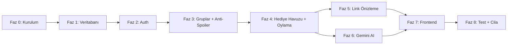

# 🗺️ CovertGift — Geliştirme Yol Haritası (Roadmap)

> Referans: [PROJECT_CONTEXT.md](./PROJECT_CONTEXT.md)
> İlerledikçe kutucukları `[x]` olarak işaretle. Her fazın sonunda **✅ Kabul Kriterleri** sağlanmadan sonraki faza geçme.
> Son doğrulama: **2026-10-17** — Backend birim testleri ve panel JavaScript sözdizimi kontrolleri geçti; Cloudflare üzerinden arayüz/API/DB erişimi doğrulandı. Kalıcı React frontend henüz başlamadı.

---

## Faz 0 — Ortam ve Proje İskeleti
- [x] Go kurulumu (`/opt/homebrew/bin/go`)
- [x] Docker Desktop kurulumu ve çalıştığının doğrulanması (`v29.8.0`, `v5.5.1`)
- [x] Git deposu başlat ve `.gitignore` yapılandır
- [x] `docker-compose.yml` → PostgreSQL 17 servisi (port `5432`, volume, healthcheck - test edildi)
- [x] `backend/` klasör yapısı (`cmd/api`, `internal/...`, `pkg/...`)
- [x] `go mod init` + bağımlılıklar: `gin`, `gorm`, `postgres`, `jwt`, `bcrypt`, `uuid`, `godotenv`, `decimal`
- [x] `.env.example` ve `.env` yapılandırması (`JWT_SECRET` üretildi)
- [x] `internal/config` → env okuma (`config.go`)
- [x] `cmd/api/main.go` ve `GET /health` endpoint'i

**✅ Kabul:** `docker compose up -d` + `go run ./cmd/api` → `GET /health` 200 döner (Doğrulandı ✅).

---

## Faz 1 — Veritabanı Modelleri ve Migrasyon
- [x] UUID desteği doğrulandı (PostgreSQL 17'de `gen_random_uuid()` yerleşiktir, pgcrypto gerekmez)
- [x] `models.User`
- [x] `models.Group` (`TargetUserID *uuid.UUID`, `TotalBudget decimal`)
- [x] `models.GroupMember` (UNIQUE `group_id,user_id`, CASCADE)
- [x] `models.GiftIdea` (`product_url` dahil, CASCADE)
- [x] `models.Vote` (UNIQUE `gift_idea_id,user_id`, CASCADE, `vote_type` CHECK IN (-1,1))
- [x] `AutoMigrate` çağrısı + bağlantı havuzu ayarları (Doğrulandı ✅)
- [x] Standart yanıt yardımcıları: `RespondOK(c, data)`, `RespondErr(c, status, msg)`

**✅ Kabul:** `psql` ile `\dt` → 5 tablo (`gift_ideas`, `group_members`, `groups`, `users`, `votes`) doğrulandı ✅.

---

## Faz 2 — Kimlik Doğrulama (Auth)
- [x] `repository/user_repo.go` (Create, FindByEmail, FindByID)
- [x] `services/auth_service.go` (bcrypt hash, JWT üretimi — 24 saat geçerlilik)
- [x] `POST /api/v1/auth/register` → 201 (e-posta çakışmasında 409)
- [x] `POST /api/v1/auth/login` → `{ token, user }` (şifre hash'i asla dönmez)
- [x] `middleware/auth.go` → `Authorization: Bearer` doğrula, `userID` context'e yaz
- [x] `GET /api/v1/me` (kullanıcı profil detayı)
- [x] `DELETE /api/v1/me` (kullanıcının kendi hesabını, oluşturduğu grupları ve verilerini silmesi)

**✅ Kabul:** Kayıt → giriş → token ile korumalı endpoint 200; tokensız 401 (Doğrulandı ✅).

---

## Faz 3 — Grup İşlemleri ve Anti-Spoiler 🛡️
- [x] `middleware/group_access.go` → `:id` grubunu yükle;
  - [x] Kullanıcı `target_user_id` ise **403** + sürpriz mesajı
  - [x] Kullanıcı üye değilse **403/404**
  - [x] Grubu ve rolü context'e yaz
- [x] `POST /api/v1/groups` (transaction: grup + oluşturan `admin` üye)
- [x] `GET /api/v1/groups` (hedef kişi olduğu gruplar filtrelenir)
- [x] `GET /api/v1/groups/:id` → `member_count`, `per_person_budget` (anlık hesap, 0'a bölme kontrolü)
- [x] `POST /api/v1/groups/:id/members` (e-posta ile; hedef kişi üye **eklenemez**; zaten üyeyse 409)
- [x] İlgi alanları listesi (2026-10-16): `POST /api/v1/groups/:id/interests` ile tüm üyeler tek tek ekleyebilir; `DELETE` ile yalnızca admin silebilir. Anti-Spoiler korunur. Eski toplu `PATCH` kaldırıldı; geçici panelde liste ve “Ekle” alanı var. Eşzamanlı eklemeler satır kilidiyle korunur.
- [x] `PATCH /api/v1/groups/:id/budget` — Admin toplam bütçeyi güncelleyebilir (2026-10-16). Kişi başı tutar ve mevcut hediye bütçe aşımı uyarıları yenilenir; geçici panelde admin için bütçe formu eklendi.
- [x] `DELETE /api/v1/groups/:id` (grubun, fikirlerin, oyların ve üyelerin admin tarafından atomik silinmesi)

**✅ Kabul:** Hedef kullanıcı tüm `/groups/:id/*` uçlarında 403 alır; listede grubu görmez (Doğrulandı ✅).

---

## Faz 4 — Hediye Havuzu ve Oylama
- [x] `GET /api/v1/groups/:id/ideas` → `score = COALESCE(SUM(vote_type),0)`, `my_vote`, skora göre sıralı
- [x] `POST /api/v1/groups/:id/ideas` → manuel öneri (`source_type = MANUAL`)
- [x] `POST /api/v1/ideas/:id/vote` → `ON CONFLICT (gift_idea_id,user_id) DO UPDATE` (GORM `clause.OnConflict`)
- [x] `DELETE /api/v1/ideas/:id` → sadece öneren veya grup admini
- [x] ⚠️ `/ideas/:id/*` uçlarında da **Anti-Spoiler**: fikrin grubunu bulup aynı kontrolü uygula

**✅ Kabul:** Aynı kullanıcı iki kez oy verince kayıt güncellenir (çoğalmaz); yetkisiz silme 403 (Doğrulandı ✅).

---

## Faz 5 — Ürün Linki Önizleme (`pkg/linkpreview`) 🔗
> Prototip: `prototypes/linkpreview/` — Modüler ayrıştırıcı mimarisi (Trendyol, Amazon TR, Hepsiburada, Generic fallback).
> Backend Paketi: `backend/pkg/linkpreview/` — Tamamen entegre edildi ve birim testleri ile doğrulandı.

- [x] Prototipi pakete taşı: `linkpreview.Fetch(ctx, url) (*Preview, error)`
- [x] Adjust tracker çözümleme (`adjust_redirect`)
- [x] Fiyat: `product:price:amount` → JSON-LD Offer fallback → state JSON
- [x] Jenerik görsel filtresi (`mrktng`, `/crm/`, `popup`, `banner`…)
- [x] 🐞 Tek/çift tırnak regex hatasını düzelt (`og:description` "Trendyol'da"da kesilmez)
- [x] HTML entity decode (`&amp;`, `&#39;`, `&imath;`, `&scedil;` vb.)
- [x] Başlıktan `search_query` türet ("- Fiyatı", satıcı adı temizliği)
- [x] 🔒 SSRF koruması: domain allowlist + dial-seviyesi özel IP engeli + 2 MB limit + max 10 redirect
- [x] `POST /api/v1/groups/:id/ideas/preview-link` endpoint'i (Anti-Spoiler korumalı, partial fallback)
- [x] Birim testleri (kaydedilmiş HTML fixture'ları ile, ağ olmadan: `go test -v ./pkg/linkpreview`)
- [x] Amazon TR / Hepsiburada / Trendyol canlı testleri ve doğrulamaları

**✅ Kabul:** `ty.gl` linki → doğru başlık + ürün görseli + 699.00 TRY; `amzn.eu` linki → hiRes ürün görseli + 1553.94 TRY; `http://127.0.0.1` reddedilir; hedef kullanıcı 403 alır (Doğrulandı ✅).

---

## Faz 6 — Gemini AI Önerileri 🤖
- [x] `pkg/gemini` istemcisi (`google.golang.org/genai`, araştırma: `GEMINI_RESEARCH_MODEL=gemini-3.8-flash`; seçim: `GEMINI_MODEL=gemini-3.5-flash-lite`)
- [x] İki aşamalı üretim: Google Search ile Türkiye mağazalarında ürün/TL fiyatı araştırması → `response_schema` ile `[{ title, description, estimated_price, search_query, evidence_ids }]` seçimi. Model URL üretmez; `ai_sources` yalnızca grounding metadata'sından gelir.
- [x] State-based prompt: `target_interests` + bütçe + mevcut başlıklar + reddedilen/veto edilen başlıklar (Kural 4)
- [x] `POST /api/v1/groups/:id/ideas/generate-ai` → en fazla 5 kaynaklı öneri, `source_type = AI`, batch insert. Yeterli geçerli ürün yoksa 3'ten az sonuç dönebilir.
- [x] 503 hatasında otomatik yedek model geçişi (`gemini-3.5-flash-lite`); araştırma/JSON ayarları yedek çağrıda korunur. Diğer API hataları üst katmana iletilir.
- [x] Kaynak, ürün adı ve fiyat eşleşmesi; pozitif tutar, veritabanı sınırları ve normalize edilmiş tekrar kontrolü için birim testleri
- [x] Bütçe üstü öneriler sunucu tarafında çöpe atılmaz; `is_over_budget: true` bayrağı ile işaretlenir (Grup toleransına bırakılır)
- [x] 👑 **Admin Vetosu:** `POST /api/v1/ideas/:id/reject` → Sadece grup yöneticisi tek tıkla reddeder (`status = REJECTED`)
- [x] 🗳️ **Demokrasi Vetosu:** Fikre verilen downvote sayısı üye sayısının yarısını geçerse ($downvotes > N/2$) otomatik `status = REJECTED`
- [x] 🔄 **Negatif Prompt Beslemesi:** Reddedilen fikirler silinmez, sonraki AI prompt'larına negatif kısıt olarak verilir

**✅ Kabul:** Kaynakla desteklenen ve doğrulamadan geçen en fazla 5 öneri DB'ye yazılır. Mevcut/reddedilmiş başlıklarla normalize edildiğinde eşleşen ürünler elenir; reddedilenler sonraki prompt'a negatif kısıt olarak eklenir. Benzer ürünlerin anlamsal olarak tamamen engellenmesi garanti edilmez. Araştırma/seçim, filtre ve 503 yedeği birim testleri geçti (2026-10-17); gerçek API testi isteğe bağlıdır ve bu oturumda tekrar çalıştırılmadı.

---

## Faz 7 — React Frontend 🎨
> 2026-10-16: Backend'i tarayıcıdan denemek için bağımsız ve geçici `prototypes/test-ui/` paneli eklendi. HTML/CSS/JavaScript + Node.js yerel proxy kullanır; kalıcı frontend'e sıfırdan başlanacak, aşağıdaki Faz 7 görevleri henüz tamamlanmış sayılmaz. Kalıcı tasarım mobil web önceliklidir.

- [x] `frontend/` → Vite + React + TypeScript (2026-10-21; React Router, TanStack Query, i18next TR/EN)
- [x] Tailwind CSS v4 + shadcn/ui (Button, Input, Label, Dialog, Sonner — elle eklendi, `radix-ui`) + Lucide Icons
- [x] `src/api/` katmanı (fetch tabanlı; Bearer token localStorage'da; 401 → token silinir, login'e yönlendirilir)
- [x] Auth sayfaları: Giriş / Kayıt (kayıt sonrası otomatik giriş)
- [x] Grup listesi + "Yeni Grup" diyaloğu (grup sayfasının ilk sürümü: bütçe, kişi başı, ilgi alanları, üyeler)
- [ ] **Ana panel (tek ekran):**
  - [ ] Üst bar: profil, toplam bütçe, kişi başı bütçe
  - [x] Orta: oylama kartları (görsel, başlık, fiyat, skor, ▲/▼, AI/MANUAL rozeti, bütçe üstü etiketi; elenenler altta katlanır bölümde)
  - [x] Kartlarda Trendyol / Amazon TR dinamik arama linkleri (`encodeURIComponent`)
  - [x] MANUAL + `product_url` varsa "Ürüne git" linki
  - [x] Sağ panel: üyeler, üye ekle; **"Gemini ile Öner"** havuz başlığında (loading durumu, 429/422/503 mesajları; canlı Gemini çağrısı arayüzden henüz denenmedi)
- [x] "Manuel Ekle" diyaloğu → link yapıştır → önizleme ile form otomatik dolar (kısmi önizlemede elle tamamlama)
- [x] AI kaynaklarını (`ai_sources`) ve Google arama önerilerini (`ai_search_suggestions`) izole biçimde göster (kaynaklar katlanır listede; öneri HTML'i betiksiz sandbox iframe'de; gerçek veriyle henüz görülmedi)
- [x] 403 Anti-Spoiler için özel "Bu bir sürpriz!" ekranı
- [x] Optimistic UI ile oylama (yanıt skor döndürmediği için ardından liste yeniden çekilir; oy yalnızca değiştirilebilir)
- [x] Toast bildirimleri, boş durumlar, iskelet (skeleton) yükleyiciler

**✅ Kabul:** Kayıt → grup kur → üye ekle → AI öner → link ile manuel ekle → oyla akışı uçtan uca çalışır.

---

## Faz 8 — Test, Güvenlik ve Cila 🧪
- [x] Swagger / OpenAPI 2.0 canlı dokümantasyonu (`swaggo/swag`, `/swagger/index.html`, `/docs`)
- [x] Veritabanı tek tıkla sıfırlama endpoint'i ve Swagger butonu (`POST /api/v1/dev/reset-db`)
- [x] Bağımlılıksız geçici test paneli ve API yolu allowlist'i; geliştirme sıfırlama ucu proxy'de engellenir
- [x] Cloudflare Quick Tunnel ile panel ve API'ye aynı HTTPS adresinden erişim; arayüz 200, sağlık kontrolü 200 (`db: up`), oturumsuz profil 401 (2026-10-17)
- [x] İlgi alanı yetkileri, bütçe doğrulaması/uyarıları, AI kaynak ve tekrar filtreleri için backend birim testleri
- [ ] Backend entegrasyon testleri (özellikle Anti-Spoiler senaryoları)
- [x] Gemini kota/istek sınırı hatasını HTTP 429 olarak döndür; istemci ve controller testleriyle doğrula
- [ ] Kalan AI hata yanıtlarını ayrıştır: kaynaksız araştırma şu an 500 döner; 422 eşlemesi ve geçici servis hataları için 503 yanıtı ekle
- [ ] CORS ayarları, istek boyutu limitleri, input validasyonu (`binding:"required,email"` vb.)
- [ ] Hata loglama (yapılandırılmış log)
- [ ] Seed script (demo kullanıcılar + grup)
- [x] `README.md` → ilk `.env` kurulumu, backend/panel/tünel komutları ve doğrulama adımları (2026-10-17)
- [x] Backend ve geçici panel için Dockerfile ve `.dockerignore`; Azure demo dağıtım rehberi
- [ ] (Opsiyonel) Backend ve paneli yerel Docker Compose yapılandırmasına ekleme

**✅ Kabul:** Temiz bir makinede README adımlarıyla proje 10 dakikada ayağa kalkar.

---

## 💡 Gelecek Fikirler (Backlog)
- [ ] **Oyu geri alma (2026-10-21):** Backend şu an yalnızca +1/−1 upsert destekliyor; oy kaldırılamıyor. `DELETE /api/v1/ideas/:id/vote` (Anti-Spoiler + üyelik kontrolü, testli) eklenip arayüzde aynı oya tekrar basınca oy kaldırılacak. Kullanıcı isteğiyle sonraya bırakıldı; frontend'de oy yalnızca değiştirilebilir.
- [ ] **Manuel önerilerden AI tercih çıkarımı (2026-10-19):** Mevcut akış manuel/AI başlıklarını yalnızca tekrar etmeme listesi olarak gönderiyor; oy skorlarını göndermiyor. Manuel önerileri, özellikle beğenilenleri, olumlu tercih örnekleri olarak kullanarak yeni ve farklı ürünler ürettir. Reddedilen/veto edilen fikirleri olumsuz bağlamda tut; mevcut tekrar, kaynak ve fiyat doğrulamalarını koru. Kullanılacak alanlar ve oy ağırlıkları uygulama sırasında netleştirilecek.
- [ ] **Trendyol önizlemesinin Azure'da çalışması (2026-10-19):** LEGO 76424 / ürün `811478750` yerelde gerçek backend paketiyle eksiksiz önizleme verdi; Azure'daki HTTP kontrolünde aynı ürün `/pl/` Polonya sayfasına yönlenip 403 döndü. `storefrontId=1&countryCode=TR&language=tr` denemesi de yönlendirmeyi engellemedi. Kullanıcı Amazon ve Hepsiburada'nın canlıda çalıştığını bildirdi. Türkiye çıkışlı ayrı önizleme servisini önce doğrula; Türkiye IP'sinin tek başına çözüm olacağı varsayılmamalı. Frontend'e taşıma seçeneği CORS ve sayfa erişimi açısından ayrıca denenecek. Manuel doldurma/partial fallback ve SSRF korumaları korunacak. Çözüm seçilmedi ve canlıya bu konuda değişiklik uygulanmadı.
- [ ] **Grup Modları:** Tek kişiye sürpriz modu (`SINGLE_TARGET`) vs. Herkes için ortak havuz / çekiliş modu (`ALL_MEMBERS`)
- [ ] E-posta ile davet linki (kayıtlı olmayan kullanıcılar için)
- [ ] Bireysel katkı takibi (kim ne kadar ödedi)
- [ ] Hediye "kazanan" seçimi ve grubu kapatma
- [ ] Önizleme sonuçlarını önbellekleme (aynı URL için 24 saat)
- [ ] Gerçek zamanlı oy güncellemeleri (WebSocket / SSE)
