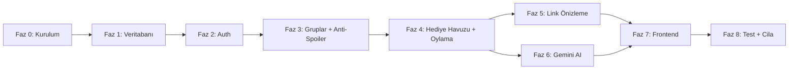

# 🗺️ CovertGift — Geliştirme Yol Haritası (Roadmap)

> Referans: [PROJECT_CONTEXT.md](./PROJECT_CONTEXT.md)
> İlerledikçe kutucukları `[x]` olarak işaretle. Her fazın sonunda **✅ Kabul Kriterleri** sağlanmadan sonraki faza geçme.

---

## Faz 0 — Ortam ve Proje İskeleti
- [x] Go kurulumu (`/opt/homebrew/bin/go`)
- [ ] Docker Desktop kurulumu ve çalıştığının doğrulanması
- [ ] Git deposu başlat (`git init`, `.gitignore`: `.env`, `node_modules/`, `dist/`)
- [ ] `docker-compose.yml` → PostgreSQL 16 servisi (port `5432`, volume, healthcheck)
- [ ] `backend/` klasör yapısı (`cmd/api`, `internal/{config,controllers,middleware,models,repository,services}`, `pkg/{gemini,linkpreview}`)
- [ ] `go mod init` + bağımlılıklar: `gin`, `gorm`, `gorm/driver/postgres`, `golang-jwt/jwt/v5`, `bcrypt`, `google/uuid`, `godotenv`
- [ ] `.env.example` → `DATABASE_URL`, `JWT_SECRET`, `GEMINI_API_KEY`, `PORT`, `CORS_ORIGIN`
- [ ] `internal/config` → env okuma
- [ ] `GET /health` endpoint'i

**✅ Kabul:** `docker compose up -d` + `go run ./cmd/api` → `GET /health` 200 döner.

---

## Faz 1 — Veritabanı Modelleri ve Migrasyon
- [ ] `CREATE EXTENSION IF NOT EXISTS pgcrypto` (gen_random_uuid için)
- [ ] `models.User`
- [ ] `models.Group` (`TargetUserID *uuid.UUID`, `TotalBudget decimal`)
- [ ] `models.GroupMember` (UNIQUE `group_id,user_id`, CASCADE)
- [ ] `models.GiftIdea` (`product_url` dahil, CASCADE)
- [ ] `models.Vote` (UNIQUE `gift_idea_id,user_id`, CASCADE, `vote_type` CHECK IN (-1,1))
- [ ] `AutoMigrate` çağrısı + bağlantı havuzu ayarları
- [ ] Standart yanıt yardımcıları: `respondOK(c, data)`, `respondErr(c, status, msg)`

**✅ Kabul:** `psql` ile `\d` → 5 tablo, tüm FK/UNIQUE kısıtları görünür.

---

## Faz 2 — Kimlik Doğrulama (Auth)
- [ ] `repository/user_repo.go` (Create, FindByEmail, FindByID)
- [ ] `services/auth_service.go` (bcrypt hash, JWT üretimi — 24 saat geçerlilik)
- [ ] `POST /api/v1/auth/register` → 201 (e-posta çakışmasında 409)
- [ ] `POST /api/v1/auth/login` → `{ token, user }` (şifre hash'i asla dönmez)
- [ ] `middleware/auth.go` → `Authorization: Bearer` doğrula, `userID` context'e yaz
- [ ] `GET /api/v1/me` (opsiyonel, frontend için faydalı)

**✅ Kabul:** Kayıt → giriş → token ile korumalı endpoint 200; tokensız 401.

---

## Faz 3 — Grup İşlemleri ve Anti-Spoiler 🛡️
- [ ] `middleware/group_access.go` → `:id` grubunu yükle;
  - [ ] Kullanıcı `target_user_id` ise **403** + sürpriz mesajı
  - [ ] Kullanıcı üye değilse **403/404**
  - [ ] Grubu ve rolü context'e yaz
- [ ] `POST /api/v1/groups` (transaction: grup + oluşturan `admin` üye)
- [ ] `GET /api/v1/groups` (hedef kişi olduğu gruplar filtrelenir)
- [ ] `GET /api/v1/groups/:id` → `member_count`, `per_person_budget` (anlık hesap, 0'a bölme kontrolü)
- [ ] `POST /api/v1/groups/:id/members` (e-posta ile; hedef kişi üye **eklenemez**; zaten üyeyse 409)

**✅ Kabul:** Hedef kullanıcı tüm `/groups/:id/*` uçlarında 403 alır; listede grubu görmez.

---

## Faz 4 — Hediye Havuzu ve Oylama
- [ ] `GET /api/v1/groups/:id/ideas` → `score = COALESCE(SUM(vote_type),0)`, `my_vote`, skora göre sıralı
- [ ] `POST /api/v1/groups/:id/ideas` → manuel öneri (`source_type = MANUAL`)
- [ ] `POST /api/v1/ideas/:id/vote` → `ON CONFLICT (gift_idea_id,user_id) DO UPDATE` (GORM `clause.OnConflict`)
- [ ] `DELETE /api/v1/ideas/:id` → sadece öneren veya grup admini
- [ ] ⚠️ `/ideas/:id/*` uçlarında da **Anti-Spoiler**: fikrin grubunu bulup aynı kontrolü uygula

**✅ Kabul:** Aynı kullanıcı iki kez oy verince kayıt güncellenir (çoğalmaz); yetkisiz silme 403.

---

## Faz 5 — Ürün Linki Önizleme (`pkg/linkpreview`) 🔗
> Prototip: `scratch/ogtest/main.go` — `ty.gl` linkinde başlık, ürün görseli ve fiyat (699.00) başarıyla çekildi.

- [ ] Prototipi pakete taşı: `linkpreview.Fetch(ctx, url) (*Preview, error)`
- [ ] Adjust tracker çözümleme (`adjust_redirect`)
- [ ] Fiyat: `product:price:amount` → JSON-LD fallback
- [ ] Jenerik görsel filtresi (`mrktng`, `/crm/`, `popup`, `banner`…)
- [ ] 🐞 Tek/çift tırnak regex hatasını düzelt (`og:description` "Trendyol'da"da kesiliyor)
- [ ] HTML entity decode (`&amp;`, `&#39;` vb.)
- [ ] Başlıktan `search_query` türet ("- Fiyatı", satıcı adı temizliği)
- [ ] 🔒 SSRF koruması: domain allowlist + özel IP engeli + 2 MB limit + max 10 redirect
- [ ] `POST /api/v1/groups/:id/ideas/preview-link` endpoint'i
- [ ] Birim testleri (kaydedilmiş HTML fixture'ları ile, ağ olmadan)
- [ ] (Opsiyonel) Amazon TR / Hepsiburada testleri

**✅ Kabul:** `ty.gl` linki → doğru başlık + ürün görseli + fiyat; `http://127.0.0.1` reddedilir.

---

## Faz 6 — Gemini AI Önerileri 🤖
- [ ] `pkg/gemini` istemcisi (`google.golang.org/genai`, model: Gemini 3 Flash)
- [ ] `response_schema` → `[{ title, description, estimated_price, search_query }]` (URL alanı **yok**)
- [ ] State-based prompt: grup açıklaması/ilgi alanları + kişi başı/kalan bütçe + `-1` oylu başlıklar + mevcut başlıklar (tekrarı önlemek için)
- [ ] `POST /api/v1/groups/:id/ideas/generate-ai` → 3-5 öneri, `source_type = AI`, transaction ile kaydet
- [ ] Hata/kota (429) yönetimi + basit rate limit (grup başına dakikada 1 istek)
- [ ] Bütçe üstü önerileri sunucu tarafında filtrele

**✅ Kabul:** Butona basınca 3-5 geçerli öneri DB'ye yazılır; downvote alan ürünler tekrar önerilmez.

---

## Faz 7 — React Frontend 🎨
- [ ] `frontend/` → Vite + React + TypeScript
- [ ] Tailwind CSS + shadcn/ui kurulumu + Lucide Icons
- [ ] `src/api/` katmanı (axios instance, JWT interceptor, 401 → login'e yönlendir)
- [ ] Auth sayfaları: Giriş / Kayıt
- [ ] Grup listesi + "Yeni Grup" diyaloğu
- [ ] **Ana panel (tek ekran):**
  - [ ] Üst bar: profil, toplam bütçe, kişi başı bütçe
  - [ ] Orta: oylama kartları (görsel, başlık, fiyat, skor, 👍/👎, AI/MANUAL rozeti)
  - [ ] Kartlarda Trendyol / Amazon TR dinamik arama linkleri (`encodeURIComponent`)
  - [ ] MANUAL + `product_url` varsa "Ürüne git" butonu
  - [ ] Sağ panel: üyeler, üye ekle, **"Gemini ile Öner"** butonu (loading durumu)
- [ ] "Manuel Ekle" diyaloğu → link yapıştır → önizleme ile form otomatik dolar
- [ ] 403 Anti-Spoiler için özel "🎁 Bu bir sürpriz!" ekranı
- [ ] Optimistic UI ile oylama
- [ ] Toast bildirimleri, boş durumlar, iskelet (skeleton) yükleyiciler

**✅ Kabul:** Kayıt → grup kur → üye ekle → AI öner → link ile manuel ekle → oyla akışı uçtan uca çalışır.

---

## Faz 8 — Test, Güvenlik ve Cila 🧪
- [ ] Backend entegrasyon testleri (özellikle Anti-Spoiler senaryoları)
- [ ] CORS ayarları, istek boyutu limitleri, input validasyonu (`binding:"required,email"` vb.)
- [ ] Hata loglama (yapılandırılmış log)
- [ ] Seed script (demo kullanıcılar + grup)
- [ ] `README.md` → kurulum ve çalıştırma adımları
- [ ] (Opsiyonel) Backend için Dockerfile + compose'a ekleme

**✅ Kabul:** Temiz bir makinede README adımlarıyla proje 10 dakikada ayağa kalkar.

---

## 💡 Gelecek Fikirler (Backlog)
- [ ] E-posta ile davet linki (kayıtlı olmayan kullanıcılar için)
- [ ] Bireysel katkı takibi (kim ne kadar ödedi)
- [ ] Hediye "kazanan" seçimi ve grubu kapatma
- [ ] Önizleme sonuçlarını önbellekleme (aynı URL için 24 saat)
- [ ] Gerçek zamanlı oy güncellemeleri (WebSocket / SSE)
