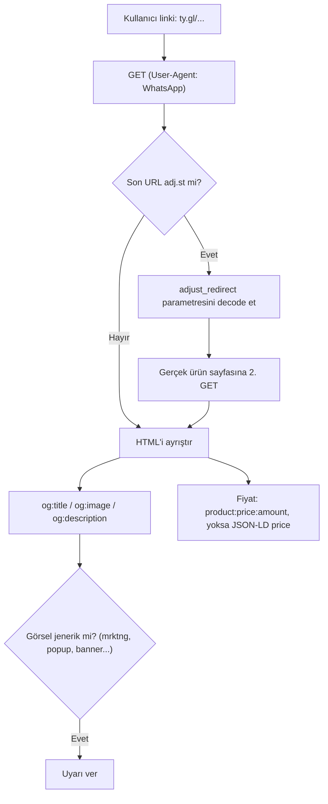

# 🔗 Prototip: Ürün Linki Önizleme

> Durum: **Deneme script'i** — üretim kodu değil. Faz 5'te `backend/pkg/linkpreview/` paketine taşınacak.
> Kural seti: [PROJECT_CONTEXT.md → İş Kuralı 5](../../PROJECT_CONTEXT.md)

## Ne işe yarar?
Kullanıcının yapıştırdığı bir ürün linkinden (ör. Trendyol paylaşım linki `https://ty.gl/...`) **başlık, açıklama, görsel ve fiyatı** çeker. Amaç: Manuel hediye önerisi eklerken formu otomatik doldurmak.

## Nasıl çalıştırılır?
```bash
cd prototypes/linkpreview
go run main.go "https://ty.gl/gkyyduf4wm8u3"
```
> `go.mod` gerekmez; sadece standart kütüphane kullanılır.

## Nasıl çalışır? (Akış)


| Fonksiyon | Görevi |
|---|---|
| `fetch` | İsteği atar (WhatsApp UA, cookie jar, 10 sn timeout), HTML + son URL döner |
| `resolveTrackerRedirect` | Adjust takip sayfasındaysa gömülü gerçek ürün URL'sini bulur |
| `extractMeta` / `extractTitle` | Meta etiketlerini ve `<title>`'ı regex ile çeker |
| `extractJSONLDPrice` | schema.org JSON-LD içinden fiyatı çeker |
| `isGenericImage` | Görselin reklam/pazarlama görseli olup olmadığını kontrol eder |

## Test sonuçları (2026-10-06, `ty.gl/gkyyduf4wm8u3`)

| Alan | Deneme 1 (ham) | Deneme 2 (düzeltilmiş) |
|---|---|---|
| Son URL | `p8zh.adj.st/...` ❌ | `www.trendyol.com/shomi/...-p-1157128859` ✅ |
| Başlık | Kesik | "shomi MD-1832 Şarjlı Yoğurmalı Boyun Ve Sırt Masaj Aleti - Isıtmalı Kulunç Ve Masaj Cihazı - Fiyatı" ✅ |
| Görsel | Pazarlama popup'ı ❌ | Gerçek ürün görseli (`/prod/...1_org_zoom.jpg`) ✅ |
| Fiyat | Yok ❌ | `699.00` ✅ |

## Öğrenilenler
1. **Kısa linkler her zaman HTTP redirect ile bitmez.** Adjust gibi tracker'lar `200 OK` + HTML döner; gerçek hedef URL parametresinde saklıdır.
2. **Tracker sayfasının OG etiketleri güvenilmez** — paylaşım anında üretilmiş jenerik pazarlama verisidir.
3. **Trendyol fiyatı OG'de değil, JSON-LD'de** veriyor.
4. Trendyol URL slug'ını kanonik hale getirmek için kendi içinde 2-3 redirect daha yapıyor (cookie jar bu yüzden önemli).

## Bilinen eksikler (Faz 5'te çözülecek)
- [ ] 🐞 Tek tırnak hatası: `content="...Trendyol'da..."` → `'` karakterinde kesiliyor. Çift/tek tırnak için ayrı regex kalıpları gerekli.
- [ ] HTML entity decode yok (`&amp;`, `&#39;`).
- [ ] Jenerik görsel tespit edilince sadece uyarı veriyor; üretimde `image_url` boş bırakılmalı.
- [ ] **SSRF koruması yok** — üretimde domain allowlist + özel IP engeli şart.
- [ ] Yanıt boyutu limiti yok (`io.ReadAll` → `io.LimitReader` 2 MB).
- [ ] JSON-LD fiyat regex'i sayfadaki *ilk* `"price"` alanını alıyor; gerçek JSON ayrıştırma daha güvenilir.
- [ ] Amazon TR / Hepsiburada henüz test edilmedi.
