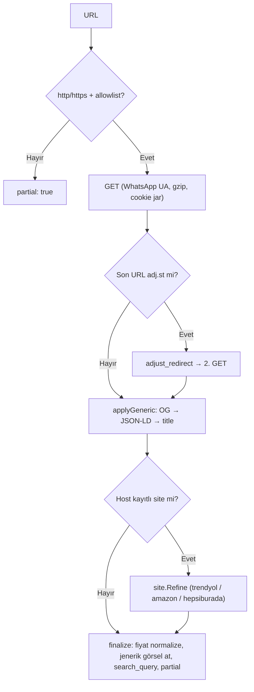

# 🔗 Prototip: Ürün Linki Önizleme

> Durum: **Deneme script'i** — üretim kodu değil. Faz 5'te `backend/pkg/linkpreview/` paketine taşınacak.
> Kural seti: [PROJECT_CONTEXT.md → İş Kuralı 5](../../PROJECT_CONTEXT.md)

## Ne işe yarar?
Kullanıcının yapıştırdığı bir ürün linkinden (Trendyol `ty.gl/...`, Amazon `amzn.eu/d/...`, Hepsiburada) **başlık, açıklama, görsel ve fiyatı** çeker. Amaç: Manuel hediye önerisi eklerken formu otomatik doldurmak.

## Nasıl çalıştırılır?
```bash
cd prototypes/linkpreview
go run *.go "https://ty.gl/gkyyduf4wm8u3" "https://amzn.eu/d/08B1hxDx"

# HTML'i kaydet (inceleme / test fixture'ı için)
LINKPREVIEW_DUMP=/tmp go run *.go "<URL>"
```
> `go.mod` gerekmez; sadece standart kütüphane. Kökteki `go.work` yüzünden `go run .` değil `go run *.go` kullanın.

## Dosya yapısı
| Dosya | Görevi |
|---|---|
| `main.go` | CLI: birden çok URL alır, özet + API JSON gövdesini basar |
| `preview.go` | `Preview` modeli, `Extractor` arayüzü, site kaydı (`extractors`), `Fetch(ctx, url)`, `finalize` |
| `fetch.go` | HTTP katmanı: WhatsApp UA, cookie jar, SSRF (allowlist + dial seviyesinde özel IP engeli), 2 MB limit, max 10 redirect, Adjust tracker çözümleme |
| `extract.go` | Ortak ayrıştırıcılar: meta (attribute bazlı), `<title>`, JSON-LD (gerçek JSON), entity decode, fiyat normalizasyonu, `search_query`, jenerik görsel filtresi |
| `generic.go` | Her site için temel katman: OG → JSON-LD → `<title>` |
| `trendyol.go` / `amazon.go` / `hepsiburada.go` | Siteye özgü `Refine` — generic sonucun üzerine yazar |

**Yeni site eklemek:** `xyz.go` içinde `Name/Hosts/Refine` yaz → `preview.go`'daki `extractors` listesine ekle. `Hosts()` aynı zamanda SSRF allowlist'ine girer.

## Akış


## Site notları (test: 2026-10-12)

| | Trendyol (`ty.gl/gkyyduf4wm8u3`) | Amazon (`amzn.eu/d/08B1hxDx`) | Hepsiburada (`...-p-HBCV00009BDBJM`) |
|---|---|---|---|
| Yönlendirme | `ty.gl` → `adj.st` (200, tracker) → trendyol.com (+3 redirect) | `amzn.eu` → `amazon.com.tr/dp/<ASIN>` (HTTP redirect) | Doğrudan |
| Başlık | JSON-LD `WebPage.name` (og:title'da "- Fiyatı" eki var) | `og:title` | JSON-LD `WebPage.name` (`Product.name` **kesik**) |
| Görsel | `og:image` (`1_org_zoom.jpg`) | `"hiRes"` — `og:image` puan basılmış **paylaşım kartı** | JSON-LD `Product.image` → `/s/777/1500/...jpg`'ye yükseltilir |
| Fiyat | JSON-LD'de Product **yok** → state JSON `discountedPrice.value` = `699.00` | OG/JSON-LD'de yok → buybox `"priceAmount"` = `1553.94` | JSON-LD `Offer.price` = `1345.00` |
| Açıklama | `og:description` | `og:description` | SEO kalıbı ("...satın alın!") → boş bırakılır |
| Dikkat | — | Captcha sayfası 200 dönebilir → uyarı | **Akamai:** `Accept-Encoding` yoksa 403. Go'nun otomatik gzip başlığı yeterli; elle set etmeyin |

## Öğrenilenler
1. **Kısa linkler her zaman HTTP redirect ile bitmez.** Adjust gibi tracker'lar `200 OK` + HTML döner; gerçek hedef URL parametresinde saklıdır.
2. **Tracker sayfasının OG etiketleri güvenilmez** — paylaşım anında üretilmiş jenerik pazarlama verisidir.
3. **Fiyat için evrensel bir kaynak yok.** Hiçbir site `product:price:amount` vermiyor; Hepsiburada JSON-LD Offer, Trendyol ve Amazon gömülü state JSON kullanıyor. Site bazlı dosyaların varlık sebebi bu.
4. **06.10 prototipindeki Trendyol fiyatı tesadüfmüş:** Sayfadaki *ilk* `"price"` eşleşmesini alıyordu; Trendyol JSON-LD'den Product'ı kaldırınca (stokta olmayan ürün olabilir) bu kırıldı.
5. **`og:image` her zaman ürün resmi değil** (Amazon paylaşım kartı). Site katmanı daha iyi kaynağı tercih etmeli.
6. Trendyol slug kanonikleştirmesi için 2-3 redirect daha yapıyor (cookie jar bu yüzden önemli).

## Çözülen eksikler (06.10 → 12.10)
- [x] 🐞 Tek tırnak hatası — meta etiketleri attribute bazlı ayrıştırılıyor (`content="..."` / `content='...'` ayrı kalıp)
- [x] HTML entity decode (`html.UnescapeString`; Amazon'un `&imath;` `&scedil;` dahil)
- [x] Jenerik görsel → `image_url` boşaltılıyor
- [x] SSRF: şema kontrolü, allowlist (`Hosts()`'tan), dial seviyesinde özel/yerel IP engeli, proxy kapalı
- [x] Yanıt limiti 2 MB, max 10 redirect
- [x] JSON-LD gerçek JSON olarak ayrıştırılıyor (`@graph`, dizi, `itemReviewed` dahil; en dolu Product seçilir)
- [x] `search_query` türetme
- [x] Amazon TR / Hepsiburada

## Kalan eksikler (Faz 5'te)
- [ ] Birim testleri: `LINKPREVIEW_DUMP` ile kaydedilen HTML'ler fixture olarak kullanılabilir (ağsız test)
- [ ] Amazon / Hepsiburada başka kategorilerde (varyantlı ürün, stokta yok, kampanyalı fiyat) denenmedi
- [ ] Hepsiburada kısa link / uygulama paylaşım domaini bilinmiyor (varsa `Hosts()`'a eklenmeli)
- [ ] Trendyol `discountedPrice` sayfadaki ilk eşleşme — çok satıcılı üründe `winnerVariant`'a sabitlemek daha güvenli
- [ ] Siteler bot korumasını sıkılaştırırsa (Akamai/captcha) `partial: true` dönüyor; kalıcı çözüm yok
